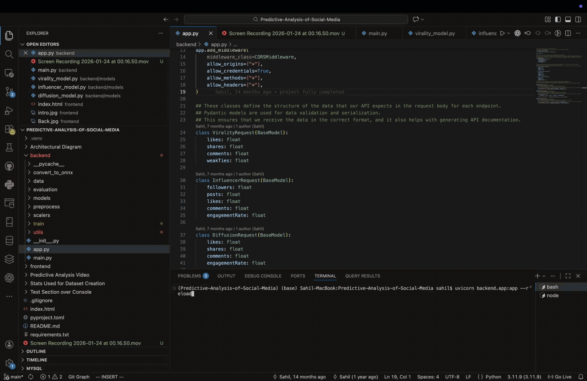

# Predictive Analysis of Social Media

This project is a web application that uses machine learning to predict the virality of social media content, identify potential influencers, and detect the spread of misinformation.

## Key Features

- **Virality Prediction:** Predicts how likely a post is to go viral based on engagement metrics.
- **Influencer Identification:** Identifies users who are likely to be influential in a network.
- **Misinformation Detection:** Analyzes content to predict its likelihood of being misinformation.
- **Web-Based Interface:** An easy-to-use interface to interact with the prediction models.

## How It Works

The application uses a set of machine learning models trained on various social media metrics. The backend is built with FastAPI and serves the prediction models through a REST API. The frontend is a simple HTML/CSS/JavaScript application that allows users to input data and get predictions from the backend.

### The Models

- **Virality Prediction (Regression):** We use an `XGBoost Regressor` to predict a numerical virality score. This model is well-suited for capturing complex relationships in the data.

- **Influencer Identification (Classification):** An `XGBoost Classifier` is used to determine whether a user is an influencer. This is a binary classification task.

- **Misinformation Detection (Classification):** We use a `LightGBM Classifier` to predict the likelihood of a post being misinformation. This model is fast and efficient, making it a good choice for this task.

## Visual Overview

### Project Working Demo



### System Architecture


## Tech Stack

- **Backend:** Python, FastAPI, Uvicorn
- **Frontend:** HTML, CSS, JavaScript
- **ML Environment:** `uv` for package and environment management

---

## Getting Started

Follow these instructions to get the project up and running on your local machine.

### Prerequisites

- [Python 3.8+](https://www.python.org/downloads/)
- [uv](https://github.com/astral-sh/uv) (a fast Python package installer and resolver)

### Installation & Setup

1.  **Clone the repository:**
    ```bash
    git clone https://github.com/your-username/Predictive-Analysis-of-Social-Media.git
    cd Predictive-Analysis-of-Social-Media
    ```

2.  **Set up the backend environment using `uv`:**
    
    First, create a virtual environment:
    ```bash
    uv venv
    ```
    
    Then, activate the environment:
    - On macOS/Linux:
      ```bash
      source .venv/bin/activate
      ```
    - On Windows:
      ```bash
      .venv\Scripts\activate
      ```
    
    Finally, install the required packages:
    ```bash
    uv sync
    ```

### Running the Application

1.  **Start the backend server:**
    ```bash
    uvicorn backend.app:app --reload
    ```
    The backend will be running at `http://127.0.0.1:8000`.

2.  **Open the frontend:**
    Navigate to the `frontend` directory and open the `index.html` file in your web browser.

---

## Regards

I made this project as my 2nd year University Project, still working and improving on it.

